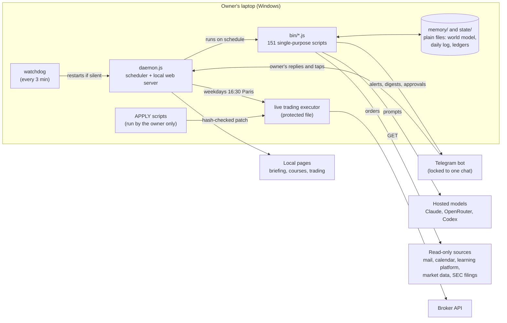

# JARVIS: a personal AI operations system, and what it taught about building one

A case study of a private project: how it was built and how it was checked. The code is private. This repository holds this write-up, one diagram and three short code
excerpts rewritten from the real code so that they run on their own.

Directed by Joshua Musick. Built with Claude Code (Anthropic), which wrote the code, the checks and the first drafts of the text. August to October 2026.

## What JARVIS is

JARVIS is a personal operations system that runs on one Windows laptop. A Node.js daemon wakes up on a
schedule, reads what has changed (mail, calendar, a university learning platform, market data), keeps
a small world model and a memory on disk, and reports through Telegram and a set of local web pages.
Its owner talks to it in a Telegram chat or a browser page with voice input.

In numbers, as of 16 October 2026:

- 342 commits since the first snapshot on 20 August 2026.
- 151 scripts in `bin/` (about 24,000 lines) plus a 1,700-line daemon. No npm dependencies, no
  build step: every script runs with plain `node`.
- 116 of those scripts have a `--selftest` mode; one runner discovers them and runs 114, leaving out the
  live-trading executor and one script whose self-test starts a real run.

What it does:

- **Scheduled jobs.** An awareness sweep about every 30 minutes, a morning briefing, an evening plan,
  a nightly reflection that turns the day's log into durable memory, a "doctor" every 5 minutes that
  checks every job and repairs the mechanical failures, and a watchdog that restarts the daemon if it
  stops answering.
- **Study tools.** One page per course built from the learning platform, deadlines read from
  announcements and mail, a message 30 minutes before each class, lecture videos turned into
  transcripts and summaries, and practice quizzes with spaced repetition. Generated quiz questions are
  checked blind before they enter the bank, and near-duplicates are rejected.
- **A real-money trading sleeve, run as a learning lab.** A small live account at a US broker trades
  once a weekday, next to two paper accounts and a paper "lab" that compares prompt variants. Its
  purpose is to measure whether an AI stock picker has any skill, under risk rules, with real costs.
- **Daily self-review.** After the US close a review runs 17 tests on the trading day and ranks the
  upgrades it finds. Nothing is applied automatically.
- **Audits by role-based AI reviewers.** Business ideas go to a council of models that vote in fixed
  roles: the named buyer, a competitor with the same AI tools, the owner's calendar, a lawyer and an
  accountant. A weekly audit has a second model re-read ten random reasons the stock picker cited and
  mark each as supported, unsupported or fabricated.

## Architecture

Three choices shape the rest.

1. **Thinking in the cloud, everything else on disk.** A research pass before the rebuild (August 2026)
   found that a local model on this laptop (no dedicated GPU, 16 GB RAM) could not carry the work.
   Language-model calls go to hosted models; the world model, the daily log and the learned memory stay as plain files that
   the owner can read and edit.
2. **Learning as curated memory, not training.** Each night a reflection run writes, updates and
   deletes memory files. A recall script searches the whole history when a conversation refers to
   something older.
3. **One protected path for money.** The chat assistant may not move money or edit the trading
   executor. That executor is a separate program the daemon starts once a weekday, and its code
   changes only through APPLY scripts that the owner runs himself (below).

## Engineering practices that are in the repository

**Self-tests per module, with negative controls.** Most scripts answer `--selftest` with fixtures and
fake network clients. Large changes also record negative controls: break one guard, confirm the test
goes red, restore the file and compare its SHA-256. The fix for the stock picker's reasons was checked
this way with 17 of 17 broken guards caught. Changed expectations are rebuilt from the definition, not
copied from the new output.

**APPLY scripts with hash checks and rollback.** For the protected files (the live executor and the
daemon) the assistant writes a script instead of an edit. Eleven such scripts are committed, and their
checks grew over time: the first three (mid-September) only keep a backup and stop when an anchor is
missing. In their full form, as in the most recent ones, they refuse to write unless the target has
the exact SHA-256 they were written against and every anchor occurs once; they keep a backup, run
`node --check` and the module's self-test, restore the original if either fails, and do nothing on a
second run. A dry run of the most recent one hashed 264 files before and after and found 0 changed.
→ [excerpts/apply-with-hash-check.js](excerpts/apply-with-hash-check.js)

**Pre-registered tests.** Rules that judge a strategy are written down before the data that will judge
them exists. The trade lab's rule (version 1) promotes a prompt variant only after 20 signal dates,
60 "up" calls and t ≥ 2.6, a Bonferroni bar for five variants, and cuts it when its upper 95 % bound
stays below zero. The comment states what the rule cannot see: weekly looks are not corrected for, so
the real false-promotion rate is above 5 %. A later rule for promoting information sources was tested
on simulated noise first. Version 1, with standard errors clustered by day only, gave a false pass in
11 % of noise runs with a 60-name pool and 15 % with a 10-name pool, where its method promises at most
5 %. Version 2 clusters by day and by stock; in its self-test, 40 pure-noise series produce no pass.
→ [excerpts/pre-registered-rule.js](excerpts/pre-registered-rule.js)

**Honest measurement.** The clearest result is a negative one: **the stock picker shows no measured
skill.** Its Brier score was 0.2499 against 0.25 for a coin (n = 57, 30 September), 0.242 (n = 92,
12 October) and 0.257 on 5-day calls (n = 14, 15 October). None of these is distinguishable from
guessing. What was done about it:

- A view now needs a verified reason: a URL, a date inside the last ten days, and a page that names
  the company and the claim. No verified reason means no view, and no view means hold, not sell.
- A trailing stop at −20 % sells without asking the model at all.
- Sizing by the model's stated confidence is scored in shadow against sizing by verified reasons,
  with a PASS/KILL rule written in advance.
- The daily review ranks "move the picker to shadow" among its upgrades.

## What went wrong and was fixed

Taken from the commit history; each fix commit records the failure, the change, what was left
undone and how it was verified.

- **A return that was not a return.** The trading page showed the live sleeve at +117 %. The sleeve
  had taken over a second sleeve's half of the account, which doubled its equity with no gain. The fix
  chains time-weighted returns only across periods with the same account share: +8.06 % for
  10 to 22 September.
- **Invented and stale news.** The picker cited a quarterly result dated a week before the quarter
  ended, and an acquisition that had closed in 2024. The cause: a flag that should have given the
  model web access was dropped in one code path, so it could not have read the news it cited.
- **"No answer" meant "sell".** An empty model answer took the same code path as "everything flat",
  and sold a position bought the day before. Now an empty or unreadable answer means hold.
- **A damaged ledger caused forced sales.** One unparseable line made the ledger reader return
  nothing, every holding looked historyless, and an exit rule sold three names per run. In the same
  review: the kill switch also switched off the stop-loss, a reconciliation compared the broker with
  itself and so could never fail, and an unknown command-line argument started a live rebalance. All
  four were reproduced on a copy with a fake broker before the fix. Runs now fail closed.
  → [excerpts/fail-closed-ledger.js](excerpts/fail-closed-ledger.js)
- **Prompt injection through memory.** A test planted an instruction in a memory file, and recall fed
  it back as fact; the assistant obeyed it. Recall now quarantines instruction-shaped lines and labels
  recalled text as untrusted data.
- **A page that always said "all done".** The home page read the wrong field and showed an empty
  to-do list while 31 tasks were open, 6 of them overdue.
- **Notification noise.** Every Telegram message rang, some at night. A design skill written for
  the project ("calm-ui": one question per page, alerts ring, everything else waits for a digest)
  set the new rules. Replaying 137 real messages
  through the new rules: messages that ring 137 → 4, night sends 10 → 0, messages per day
  7.2 → 4.1.
- **Business ideas that went nowhere.** Six venture proposals earned nothing. They failed the same
  way: no named buyer, assets built before anyone said yes, and plans that stalled at the first step
  needing the owner. Proposals now need a buyer, an edge, a seven-day demand test and an estimate of
  the owner's minutes before the council votes. The hard rules stay: nothing is published in the
  owner's name, no platform terms are broken, and the venture loop moves no money.

## Limits

- **The sleeve still breaks its own rules.** The review of 15 October measured a 10.6 % drawdown from
  the 6 October peak, a beta of 2.31 to the S&P 500 ETF, and 8 holdings against a limit of 5. The
  review flags these; fixing them needs further APPLY scripts.
- **Several safety fixes came after the failure, with real money at stake.** The protected-file
  process makes changes careful. It did not make the first version safe.
- **Defences built on a language model are probabilistic.** The same injection attack was blocked
  in one run and obeyed in the next. Deterministic filters and hard permission limits reduce the
  damage; they do not remove the risk.
- **"Always on" means while the laptop is awake.** A good part of the reliability work deals with
  sleep, missing network and catch-up after wake-up.
- **Some checks were never seen end to end,** for example how folded digests look on a phone. The
  commits say so, often with the word UNVERIFIED.

## Lessons

1. Put the money path behind a door the assistant cannot open.
2. When a check cannot fail, it is not a check. Every guard needs a test that breaks it on purpose.
3. Measure the skill before scaling the strategy. A Brier score next to the coin's 0.25 says more
   than a month of returns.
4. Fail closed. An empty answer, an unreadable file or a mismatch should stop orders, not trigger them.
5. Write the rule before the data arrives, and change it only as a new, dated version.

## Authorship

Directed by Joshua Musick. Built with Claude Code (Anthropic), which wrote the code, the checks and the
first drafts of the text. In JARVIS itself, 231 of the 342 commits carry a Claude co-author line;
10 were committed under a Codex identity and 56 under JARVIS's own.

The excerpts in `excerpts/` are rewritten from the real code, without paths, keys or account data.
Each runs on its own: `node excerpts/<file>.js`. Licence: MIT ([LICENSE](LICENSE)).
